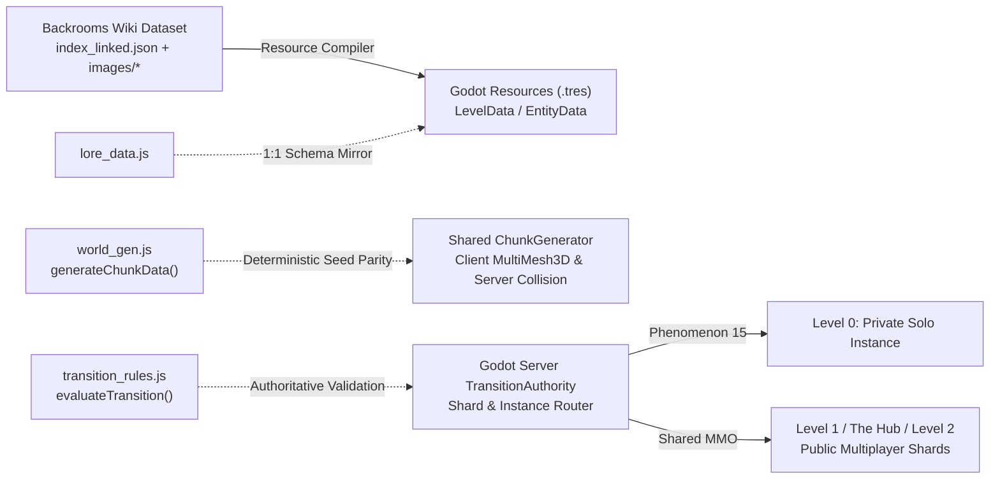

# Backrooms Wiki 一次設定抽出・3D探索プロトタイプ & Godot 4.3 MMO拡張設計仕様書

> **ライセンスおよび一次出典表記 (CC-BY-SA-3.0)**  
> 本仕様書および関連データセット・プロトタイプ実装に含まれる設定情報・画像メタデータ・テキスト引用は、Fandom版「The Backrooms Wiki」（[https://backrooms.fandom.com/wiki/Backrooms_Wiki](https://backrooms.fandom.com/wiki/Backrooms_Wiki)）より MediaWiki Action API（`https://backrooms.fandom.com/api.php`）経由で取得した一次データを基に構成されており、**[CC-BY-SA-3.0](https://creativecommons.org/licenses/by-sa/3.0/)** ライセンスの下で帰属表示・継承されます。

---

## 1. 取得データセット概要・一次出典メタデータ

`fetch_wiki_linked.py` による MediaWiki Action API 取得結果（`dataset/manifest.json` および `dataset/index_linked.json` より）：

| 項目 | 実績値 / 参照先 |
| :--- | :--- |
| **Wiki出典** | Backrooms Wiki (Fandom) — `https://backrooms.fandom.com/wiki/Backrooms_Wiki` |
| **APIエンドポイント** | `https://backrooms.fandom.com/api.php` |
| **ライセンス** | `CC-BY-SA-3.0` (`https://creativecommons.org/licenses/by-sa/3.0/`) |
| **取得ページ数** | 1,721 / 1,721 ページ（非リダイレクト `namespace=0` 全件、`pages_failed = 0`） |
| **参照一意ファイル数** | 8,326 件（画像対象 7,753 件 / 非画像音声等スキップ 547 件 / imageinfo欠損 26 件） |
| **画像ダウンロード成功** | 7,753 件（失敗 0 件、`format=original` 優先による実形式保持） |

### プロトタイプ採用コアページの厳密メタデータ

| 階層 / オブジェクト | Page ID | Revision ID | 取得タイムスタンプ (UTC) | ローカル一次Markdownパス | 出典URL |
| :--- | ---: | ---: | :--- | :--- | :--- |
| **Level 0 ("The Lobby")** | 83 | 1397338 | `2026-11-15T18:52:48Z` | `dataset/pages/Level_0__83.md` | https://backrooms.fandom.com/wiki/Level_0 |
| **Level 1 ("The Parking Lot")** | 90 | 1390128 | `2026-11-03T15:53:15Z` | `dataset/pages/Level_1__90.md` | https://backrooms.fandom.com/wiki/Level_1 |
| **The Hub** | 61845 | 1306303 | `2026-08-04T01:59:35Z` | `dataset/pages/The_Hub__61845.md` | https://backrooms.fandom.com/wiki/The_Hub |
| **Level 2 ("Pipe Dreams")** | 120 | 1339266 | `2026-09-07T23:13:10Z` | `dataset/pages/Level_2__120.md` | https://backrooms.fandom.com/wiki/Level_2 |
| **Object 1 (Almond Water)** | 141 | 1395027 | `2026-11-11T21:50:11Z` | `dataset/pages/Object_1__141.md` | https://backrooms.fandom.com/wiki/Object_1 |
| **Object 2 (Level Keys)** | 56596 | 1329482 | `2026-08-30T17:05:51Z` | `dataset/pages/Object_2__56596.md` | https://backrooms.fandom.com/wiki/Object_2 |

---

## 2. 一次記事に基づく階層設定抽出

### 2.1 Level 0: "The Lobby"
- **出典**: `dataset/pages/Level_0__83.md`（`https://backrooms.fandom.com/wiki/Level_0`）
- **サバイバル難易度クラス**: Custom Class（カラー `#75623e` / `Unstable` / `Devoid of Entities`）
- **環境描写・空間特徴**:
  - 時代遅れの小売店舗の裏空間（dated retail outlet）に似た広大な非ユークリッド空間。
  - 直進して元の位置に戻ったつもりでも異なる部屋群に到達するなど、線形空間と位相が歪んでおり、方向感覚と精神安定性を著しく損なう。
  - 家具がかつて置かれていたような凹みを持つ摩耗した湿ったカーペット（謎の液体が染み込んでおり飲用不可）、矢印や垂直線パターンを帯びた黄ばんだ壁紙、点在する電源コンセントと空の差込口。
  - 天井裏（drop ceiling）の上には約1mの埃まみれで呼吸困難な配線・ダクト空間が存在する。
- **照明・音響**:
  - 不規則に配置された蛍光灯から発せられる強烈で執拗なハム音（hum-buzz）が偏頭痛を誘発する。
- **エンティティ / 現象**:
  - **Phenomenon 15** により生物・他探索者は一切存在しない（`"Devoid of Entities"`）。他の探索者の目撃報告は長時間の孤立による視聴覚幻覚とされる。将来のMMOでは「完全ソロ隔離インスタンス」として表現する根拠となる。
- **ノークリップ・遷移条件**:
  - 空間内の任意の箇所（特に不安定な壁面境界）からの **Noclipping** により、Level 0サブレベルまたは Level 1〜8等へ遷移。
  - 十分に長距離を彷徨う（`DISTANCE_DRIFT`）ことで廊下が徐々に **Level 1** の駐車場・ガレージ空間へ変質する。
  - 階段（stairwells）を上ることで **Level 1** へ到達。
  - 非常口（Exit扉）から Level 0.01 / Level 14 / Level ! 等へ繋がる場合がある。
- **参照画像（一次紐付け）**:
  - `File:Thebackrooms.jpg` → `dataset/images/Thebackrooms__229a8508a0.jpg`（2019年5月4chan初出写真 / Hobbytown Oshkosh）
  - `File:Wallpaper.png` → `dataset/images/Wallpaper__7a9c233d8d.png`（壁紙パターン / CC BY-SA系Wikimedia Commons出典）
  - `File:Dated level 0 photograph.png` → `dataset/images/Dated_level_0_photograph__8b3c00a038.png`
  - `File:Level 0 alt.png` → `dataset/images/Level_0_alt__cb2859972e.png`

### 2.2 The Manila Room（Level 0 内空間異常）
- **出典**: `dataset/pages/Level_0__83.md`（`===The Manila Room===` セクション）
- **サバイバル難易度クラス**: Level 0 内の孤立異常空間（実質安全地帯 / 一時的休息点）
- **環境描写・照明**:
  - Level 0 と共通の湿ったカーペット・蛍光灯の特性を持ちつつ、壁面全体に独特の落ち着いた **マニラ紙調パターン（Manila pattern）** が施されている。
  - 周囲の Level 0 より明らかに暗い **オレンジがかった単一の天井灯** によって照らされる。
  - 近づくと感覚が鈍麻し、壁の向こうから微かな不穏な囁き声（幻聴とも推測）が聞こえる。Phenomenon 12 による時折のブラックアウトが報告されている。
- **遷移条件**:
  - Level 0 内のランダムな位置（プロトタイプでは特定チャンク座標に決定論的配置）に出現する休息点であり、一定時間滞在・インタラクトすることで **Level 1** または **Level 2** への安定した出口として機能する。
- **参照画像（一次紐付け）**:
  - `File:Manila Room.png` → `dataset/images/Manila_Room__8c1ecbd38f.png`

### 2.3 Level 1: "The Parking Lot"
- **出典**: `dataset/pages/Level_1__90.md`（`https://backrooms.fandom.com/wiki/Level_1`）
- **サバイバル難易度クラス**: **Class 2**（`Safe` / `Stable` / `Moderate Entity Count`、グレー基調 `#808080`）
- **環境描写・空間特徴**:
  - 屋内駐車場と倉庫が融合した階層で、上方向に **2,000階**（各階 約650,000 km²、天井高 **4〜5m**）延びる。
  - むき出しでひび割れ（cracks and fractures）の走るコンクリート壁、階数を記したコンクリート柱、何もない壁面を指す偽のExit標識。
  - 充電に使用可能な壁コンセント、ナンバープレート・ブランド表記のない故障車（赤・青・白・黒の特殊合金製）、錆びた鉄筋・配管。
  - 床一面に滞留する **Hydrolitis Plague** 汚染水たまりが蒸発し、濃霧と高湿度（通常27℃、局所的に50℃）を生む。
  - 派生区画として木製扉の先の「倉庫（Warehouses / 34℃）」、黒色金属扉の先の「メンテナンスホール（Maintenance Halls / 白壁・水たまり無し・Almond Water配管・独立電源）」、最上階「The Roof」が存在する。
- **照明・ハザード（ブラックアウト）**:
  - 不規則に大規模停電（**Blackouts**）が発生し、壁コンセントへの給電も停止する。暗闇ではエンティティ活動が急増するため懐中電灯が必須。
- **エンティティ / 集団**:
  - **Smilers**（停電中のみ積極狩猟）、**Hounds**（Level 1では比較的臆病で威嚇により退散可能）、**Dullers**、**Clumps**、**Deathmoths**、**False Puddles**（深さ1.5〜3.6mの捕食擬態水たまり）、**Pipe Slugs**、**Hydrolitis Plague**。
  - M.E.G.（Almander）や Backroom Colonists（Base Blink）などの開拓拠点が存在する。
- **ノークリップ・遷移条件**:
  - 階段（Staircases）により **Level 0** または **Level 2** へ移動。無施錠の扉から **Level 2** へ移動。
  - **The Hub への確定シーケンス**: 階段を2階分上って即座に下り、分岐通路で **左通路 → 右通路** と進み、**"A" と "B" の扉に対して「Bの扉に入り、反対側のAの扉へ入る」** ことで **The Hub** へ到達。
  - コンセント付きの壁への Noclip により Level 188 等へ遷移（プロトタイプでは不安定境界ノークリップとして Level 2 / Level 0 遷移にも接続）。
- **参照画像（一次紐付け）**:
  - `File:Level 1.jpg` → `dataset/images/Level_1__e8e28d1950.jpg`
  - `File:SolusLevel1.jpg` → `dataset/images/SolusLevel1__fda38a012a.jpg`
  - `File:Level1Warehouse.jpeg` → `dataset/images/Level1Warehouse__9a55eb1a79.jpeg`
  - `File:Level 1 Hallway.jpg` → `dataset/images/Level_1_Hallway__724a41cdd4.jpg`
  - `File:False Puddle.jpg` → `dataset/images/False_Puddle__54b6916afa.jpg`
  - `File:Level1Again.webp` → `dataset/images/Level1Again__ccb5856b94.webp`

### 2.4 The Hub
- **出典**: `dataset/pages/The_Hub__61845.md`（`https://backrooms.fandom.com/wiki/The_Hub`）および `Object_2__56596.md`
- **サバイバル難易度クラス**: **Class Nexus**（`Exit: 0/5 Guaranteed Exit` / `Environment: ?/5 Everchanging` / `Entities: ?/5 Diverse Entity Count`、ゴールド基調 `#DAA520`）
- **環境描写・空間特徴**:
  - レンガおよび巨大コンクリートスラブで構成された地下トンネル網で、Backrooms各階層への **ハブ（Nexus）** として機能する。
  - トンネル底面には平滑な **アスファルト道路** と両側の細い歩道が走り、天井沿いの金属パイプには Almond Water と Liquid Pain の混合液が通る。
  - 交通量ゼロにも関わらずネオン交通標識や、数分ごとに言語が切り替わる壁掛けTVモニターが点在。
  - 気温は氷点下の **約25°F (-3.8℃)** で巨大換気ファン群により冷却されるが液体は凍結しない。床面は異常なほど清潔で漂白剤のような微香があり、汚れや液体は数秒で吸収消滅する。
  - 各所には階層番号・名称と専用紋章が刻まれた金属製の **Level Doors** が点在し（例: Level 0 の扉は淡い黄色味を帯び、シェブロン模様の **Object 2: Level Key** と共鳴する）、対応する **Level Key** で解錠することで各階層へ転移できる。
- **照明・音響**:
  - 等間隔のオレンジ〜黄色照明が配置され、時折 **赤・オレンジ（稀に紫・緑）へ色相変化（Hue Shift）** を起こす。
  - 数分ごとにピッチが変化する静かな低周波ハム音がトンネルに響く。
- **エンティティ**:
  - **Skin-Stealers**, **Hounds**, **Deathmoths** が生息するが広大なため遭遇は稀。**Smilers などの闇属性無定形エンティティは特異的に不在**。
- **遷移条件**:
  - 入口：Level 1 の「階段2上1下→左→右→Door B→Door A」シーケンス、Level 37 / Level 154 接続通路。
  - 出口：**Object 2 (Level Key)** により解錠された各種 Level Door（Level 0, Level 1, Level 2 等へ確定遷移）。
- **参照画像（一次紐付け）**:
  - `File:Tunnel.webp` → `dataset/images/Tunnel__d36fe2f1d2.webp`
  - `File:Now THIS is the hub.png` → `dataset/images/Now_THIS_is_the_hub__08bb5ae4c3.png`
  - `File:Hubdoor.png` → `dataset/images/Hubdoor__4a30440d03.png`
  - `File:Whitehubdoor.png` → `dataset/images/Whitehubdoor__58c7c5564a.png`
  - `File:A Stash of Level Keys.jpg`（`Object 2`）→ `dataset/images/A_Stash_of_Level_Keys__eac6b3da7d.jpg`

### 2.5 Level 2: "Pipe Dreams"
- **出典**: `dataset/pages/Level_2__120.md`（`https://backrooms.fandom.com/wiki/Level_2`）
- **サバイバル難易度クラス**: **Class 2**（`Unsafe` / `Stable` / `Low Entity Count`、錆金属基調 `#6f4e37`）
- **環境描写・空間特徴**:
  - 相互接続された保守用ユーティリティトンネル、メンテナンスシャフト、そして壁面沿いに走る膨大な **錆びた配管群** で構成される。
  - Level 0 のようなライブ空間変形（非ユークリッド転移）は基本的に起きないユークリッド構造だが、初心者探索者には家具や扉の幻覚的レイアウト変動（**Clockwork Theory**）が生じることがある。
  - 蒸気管周辺は **60〜100℃** に達する一方、換気ダクト付近は低温で冬季には雪や氷が張る極端な温度差を持つ。無線の通信機器は完全に機能不全を起こす。
- **エンティティ / 遷移条件**:
  - **Clumps**, **Hounds**, **Smilers**, **Skin-Stealers**, **Windows**, **The Biological Pipeline**。
  - 出口：非常口（Fire Exits）経由で **Level 1**（または Level 3）、クロールスペースや特定通路で他階層へ帰還・進行。
- **参照画像（一次紐付け）**:
  - `File:Level2main.png` → `dataset/images/Level2main__964773df02.png`
  - `File:Rusty texturelevel2.png` → `dataset/images/Rusty_texturelevel2__5c83402352.png`
  - `File:Spoopy level2.png` → `dataset/images/Spoopy_level2__d8277fb786.png`
  - `File:Cleanlevel2.jpg` → `dataset/images/Cleanlevel2__6645008516.jpg`
  - `File:Pipeline1.jpg` → `dataset/images/Pipeline1__d79693d772.jpg`

---

## 3. 3D一人称視点（FPS）探索プロトタイプ設計仕様

### 3.1 操作系・UI・フィードバック仕様
| 入力 | 動作 | 実装先 |
| :--- | :--- | :--- |
| `W / A / S / D`（矢印上下） | 前進・後退・ストレイフ移動（水平A/D） | `main.js` |
| `Shift` | スプリント（足音ピッチ・ヘッドボブ加速） | `main.js` |
| マウス移動（Pointer Lock） | 一人称視点回転（Yaw無制限 / Pitch ±85°制限） | `main.js` |
| `Q / E`（注：`ArrowLeft/Right`回転代替） | Pointer Lock 非対応環境向け視点回転フォールバック（`← / →`） | `main.js` |
| `F` | 懐中電灯（`THREE.SpotLight`）ON/OFF＋クリック音 | `main.js` + `audio_synth.js` |
| `E` | コンテキストインタラクト（扉開閉 / Manila休息 / Door B→A / Level Key取得 / 階段） | `main.js` + `transition_rules.js` |
| `N` | 不安定境界壁（`GLITCH_WALL` / `OUTLET_WALL`）近接時の Noclip 発動 | `main.js` + `transition_rules.js` |
| `M` / `H` | Web Audio ミュート切替 / HUD 表示切替 | `main.js` + `audio_synth.js` |

### 3.2 Web Audio API プロシージャル音響設計 (`audio_synth.js`)
外部音声ファイルの読み込みに依存せず、`AudioContext` 上で階層固有の常時アンビエンスと効果音を合成する：
- **Level 0**: 60Hz / 120Hz / 180Hz の矩形・ノコギリ波混合＋不安定LFOによる蛍光灯ハム音。
- **Manila Room**: 減衰させた低周波ハム音＋バンドパス・ノイズによる「壁の奥の微かな囁き」。
- **Level 1**: 重低音空調ドローン＋ブラックアウト発生時のリレー遮断クリック＆無音化演出。
- **The Hub**: 地下トンネル共鳴音（ゆっくり音程ドリフト）＋高速換気ファン風切り音。
- **Level 2**: 金属共鳴パイプドローン＋高周波スチーム漏出音。
- **SFX**: 足音（階層床材ごとに質感変化）、懐中電灯スイッチ、Noclip時グリッチ周波数スイープ、金属扉開錠・遷移音、Level Key取得共鳴チャイム。

### 3.3 シード決定論的チャンク無限迷宮 (`world_gen.js`)
- **グリッド定数**: `CHUNK_CELLS = 8`, `CELL_SIZE = 3.0m`, `CHUNK_WORLD_SIZE = 24.0m`
- **ストリーミング範囲**: `loadRadius = 2`（プレイヤー周囲 5×5 = 25チャンク維持）、`unloadRadius = 3`（チェビシェフ距離 > 3 で幾何メモリ・シーンから即時破棄）。
- **チャンク境界シーム整合**: 隣接チャンク `(cx, cz)` と `(cx+1, cz)` 間の境界セル通行可否を、両者の辺ID（正規化ペア座標）に対する同一ハッシュ関数 `isBorderOpening(worldSeed, levelId, ax, az, bx, bz)` で決定するため、どの順序でチャンクを生成しても廊下が必ず繋がり、かつ `(levelId, cx, cz, worldSeed)` のみで **100% 決定論的（Byte-identical）** に再現される。
- **テクスチャデュアル読込**: まず同期的に Canvas 2D プロシージャルテクスチャ（黄ばんだ矢印壁紙、湿ったカーペット、ひび割れコンクリート、マニラ幾何模様、錆配管など）を生成・適用し、非同期で `../dataset/images/...` および `./assets/textures/...` の Wiki 実画像の読込を試行して成功時にマテリアルを差し替える。ローカル制限（`file://` CORS等）や欠損時もエラー無く動作継続する。

### 3.4 決定論的ノークリップ＆遷移ルール (`transition_rules.js`)
プレイヤー座標・ワールドシード・現在階層・進行コンテキストを受け取る純粋関数 `evaluateTransition()` により、描画状態から完全に独立した形で遷移可否と遷移先を決定する：
- `level_0` + `NOCLIP_WALL` → `(worldSeed, cx, cz)` ハッシュにより `level_1`（70%）または `level_2`（30%）へ決定論的遷移。
- `level_0` + `DISTANCE_DRIFT` → 原点からのユークリッド距離 ≥ 120m で `level_1` へ自然移行。
- `level_0` + `MANILA_ENTER` → `manila_room` へ入室；`manila_room` + `MANILA_REST` → `level_1` または `level_2` へ確定脱出。
- `level_1` + `HUB_SEQUENCE` → 状態機械で **Door B → Door A** の順に触れた場合のみ `the_hub` へ遷移許可。
- `the_hub` + `HUB_DOOR` → `Object 2 (Level Key)` 所持時のみ解錠し、指定階層（`level_0` / `level_1` / `level_2` / `manila_room`）へ転移。

---

## 4. Godot 4.3 マルチプレイMMO拡張アーキテクチャ

プロトタイプ段階でドメイン知識・生成ロジック・遷移判定をすべて純粋ESモジュールへ分離したことで、Godot 4.3（GDScript + C#/GDExtension + `ENetMultiplayerPeer` / `WebSocketMultiplayerPeer`）への移植・MMO化は以下のように 1対1 で対応づく：



### 4.1 モジュール対応と責務分離マッピング

| プロトタイプJSモジュール | 現在の責務 | Godot 4.3 MMO 移行先コンポーネント | ネットワーク / 権威モデル |
| :--- | :--- | :--- | :--- |
| `lore_data.js` | 階層環境・照明・難易度・エンティティ・CC-BY-SA-3.0帰属メタデータ | `res://data/levels/*.tres`（`LevelDefinition extends Resource`） | `index_linked.json` からビルド時に自動生成。クライアント・サーバー共通参照 |
| `world_gen.js` | シード決定論的8×8チャンク生成・境界接続・AABB衝突解決 | `ChunkGenerator.gd` + `ChunkStreamer.gd`（`MultiMeshInstance3D`） | **帯域ゼロ地形同期**：クライアントは `world_seed` と `(level_id, cx, cz)` のみ受信してメッシュ構築。サーバーは同一アルゴリズムで移動・衝突を検証 |
| `transition_rules.js` | ノークリップ・Door B→A・Level Key判定と遷移グラフ | `TransitionAuthority.gd`（`@rpc` サーバー権威ステートマシン） | クライアントは `request_transition(trigger_type, pos, ctx)` を送信し、サーバーが `world_seed`・所持鍵・シーケンスを検証後にインスタンス切替を承認 |
| `audio_synth.js` | 階層別アンビエンス・ブラックアウト音・空間効果音 | `AudioManager.gd`（`AudioStreamPlayer3D` + Bus Reverb/Filter） | サーバーの `BlackoutEvent` や周囲プレイヤー足音RPCを受けて空間減衰再生 |
| `main.js` | Three.js描画・Pointer Lock入力・HUD表示・GPUリソース破棄 | `PlayerController.gd` (`CharacterBody3D`) + `HudCanvas.gd` | `MultiplayerSynchronizer` による位置補間（20Hz）およびサーバー権威Blackout同期 |

### 4.2 MMO拡張用 ネットワークパケット・状態スキーマ（設計仕様）

```json
{
  "PlayerStatePacket": {
    "peer_id": 1042,
    "instance_id": "level_1_shard_01",
    "level_id": "level_1",
    "chunk": { "cx": 1, "cz": 0 },
    "position": [28.5, 1.7, 10.2],
    "yaw": 1.57,
    "flashlight_on": true,
    "has_level_key": true,
    "hub_seq_step": "door_b_entered"
  },
  "TransitionRequestRPC": {
    "current_level_id": "level_1",
    "trigger_type": "HUB_SEQUENCE",
    "world_seed": 1999,
    "player_pos": { "x": 37.5, "z": 10.5 },
    "context": { "sequenceStep": "door_a_after_b", "hasLevelKey": false }
  },
  "TransitionCommitRPC": {
    "allowed": true,
    "target_level_id": "the_hub",
    "target_instance_id": "the_hub_nexus_01",
    "instance_mode": "shared_shard",
    "spawn_pos": { "x": 1.5, "z": 1.5 },
    "rule_id": "L1_TO_HUB_SEQUENCE"
  }
}
```

### 4.3 Phenomenon 15 に準拠したインスタンスルーティング方針
- `level_0` および `manila_room` は一次設定（*Phenomenon 15: Devoid of Entities / impossible to meet another wanderer*）に基づき、MMOサーバー側で `mmoInstanceMode = "solo_isolated"` として独立プライベートインスタンスを割り当てる。
- プレイヤーが `level_1` / `the_hub` / `level_2`（`mmoInstanceMode = "shared_shard"`）へ遷移した瞬間に公開MMOシャードへ合流させ、**Level 0 の孤独感からマルチプレイの協調探索・拠点形成（Base Blink / Almander）へ劇的に切り替わる Backrooms 準拠体験**を実現する。
